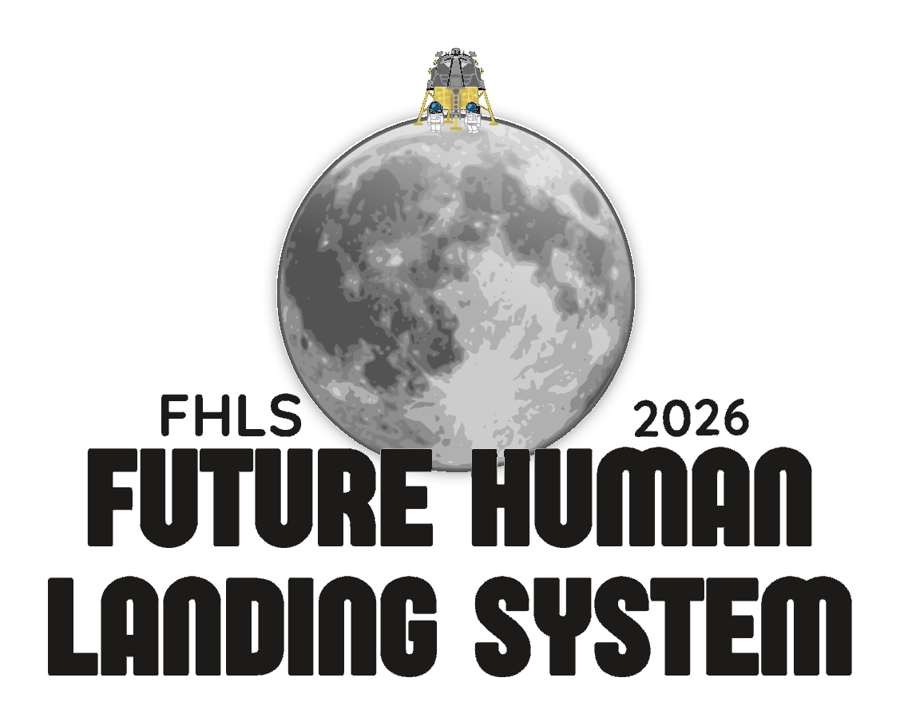
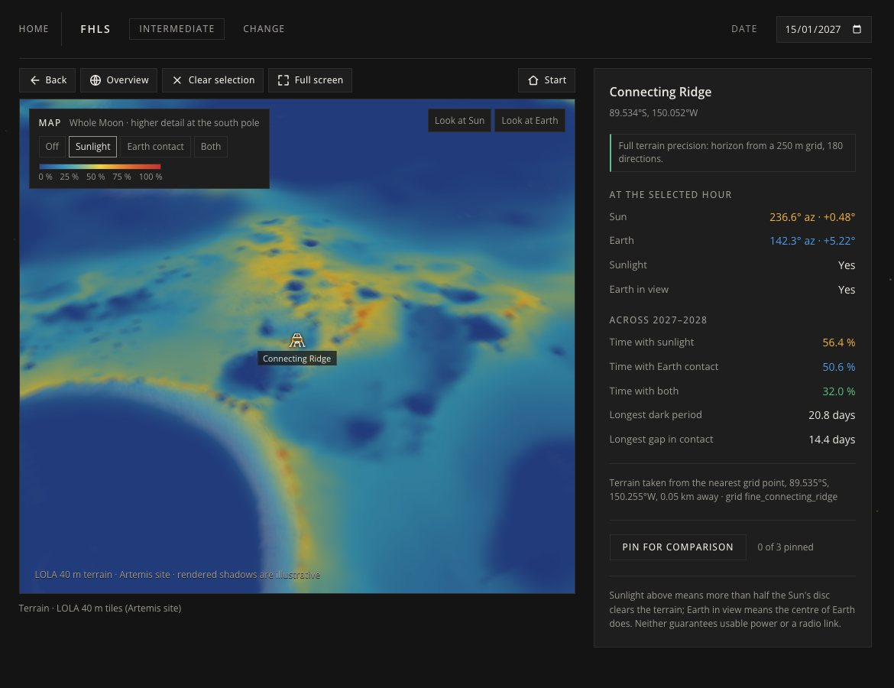
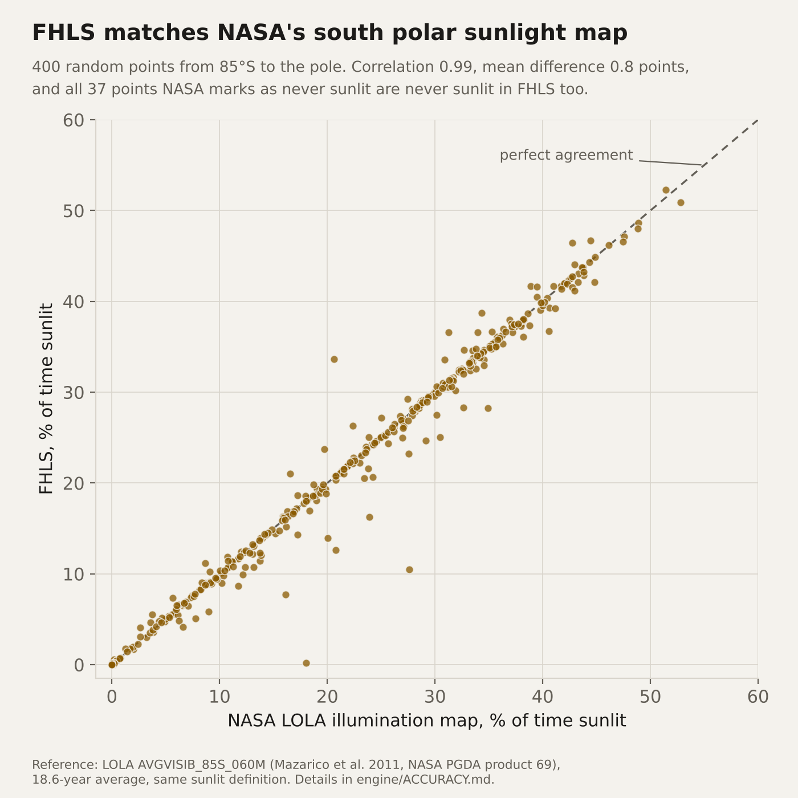

<p align="center">
  <picture>
    <source media="(prefers-color-scheme: dark)" srcset="design/logo/fhls-logo-transparent.png">
    
  </picture>
</p>

<p align="center"><b>FHLS – Future Human Landing System</b></p>

Click any spot on the Moon. See when it gets sunlight and when it can see Earth, hour by hour through 2027 and 2028, measured against that spot's own horizon. Those two things decide whether a lander has power and a direct line home.

**Try it live:** https://learnsonme.github.io/Future-Human-Landing-System-FHLS-/

**Demo video (Beginner mode):** https://youtu.be/xXaZwpt-LBo

**NASA Space Apps 2026:** [our team page](https://www.spaceappschallenge.org/2026/find-a-team/future-human-landing-system-fhls/)



### Why this is hard
At the lunar south pole, where Artemis crews will land, the Sun never climbs more than about 1–2° above the horizon, and Earth wobbles by up to about ±6.7° over a month. At angles that low, a crater rim a few hundred metres away decides whether solar panels get light and whether a lander can see Earth. Two spots 1 km apart can have completely different years.

### What you can do with it
- **Any spot on the Moon:** click the 3D Moon, or pick one of 26 candidate sites (Artemis regions, the six Apollo sites, famous craters). A small lander marks your spot.
- **Sun and Earth against the real skyline,** for all 17,544 hours of 2027–2028, from NASA terrain and JPL ephemerides.
- **Three modes:** Beginner (a plain yes/no and one sentence), Intermediate (angles, percentages, windows), Advanced (exact numbers, an hour-by-hour table, CSV export).
- **Heat maps over the whole Moon:** sunlight, Earth contact, both, longest blackout, per month. Higher detail (250 m) at the south pole.
- **Horizon panorama:** the site's real skyline with the Sun and Earth moving across it, with its own time slider and a Play button.
- **Best landing dates:** for any spot, the three longest stretches with both sunlight and Earth in view, plus the longest blackout. Click one to jump straight to it. Far-side and never-sunlit spots get their own answer.
- **Pick an exact moment:** type a date and hour (UTC), step by an hour or a day, or use the arrow keys on the slider.
- **Compare up to 3 sites** side by side, including their best landing window, with numbered markers on the Moon.
- **Light and dark mode,** keyboard controls, phone layout and full screen.

### What it shows: two Artemis sites, very different years
Two Artemis candidate sites near the south pole look similar on a map. FHLS shows they are not:

| Site (2027–2028) | Best landing window | Longest blackout |
| --- | --- | --- |
| Connecting Ridge | 2–14 Dec 2027, 11.6 days | 20.8 days |
| de Gerlache Rim 2 | 24 Oct–2 Nov 2028, 9.0 days | 115.2 days (10 Feb–4 Jun 2028) |
| Faustini Rim A | 5–8 Oct 2028, 3.7 days | 146.5 days |

A lander at Connecting Ridge waits at most three weeks for sunlight; at de Gerlache Rim 2 it would sit in the dark for almost four months. That's the kind of difference FHLS is built to reveal in one click.

### How it works
```
NASA data ──► engine/ (Python, run once) ──► data/ (small files) ──► browser (core/ + viewer/ + web/)
SPICE, LOLA     horizons, ephemeris,          JSON, binary,           combines them for any click
                terrain tiles, heat maps      PNG tiles               in about 10 ms
```
- **Engine (`engine/`):** for each grid point it looks out in 180 directions across LOLA elevation data and records the highest terrain angle, which gives that point's skyline. Grid points sit every 2 km around the south pole, every 250 m at the Artemis sites, and every 0.25° over the whole Moon. It also places the Sun and Earth for every hour from JPL SPICE.
- **Browser (`core/`, `viewer/`, `web/`):** no server. The site loads the precomputed files, and `core/fhls-core.js` combines the skyline and the ephemeris for the spot you clicked. The 3D Moon is three.js with real LOLA terrain tiles.

### The NASA data behind it
- **JPL NAIF SPICE:** DE440s planetary ephemeris, Moon PA/ME frame kernels (`moon_de440_250416.tf`), `pck00011.tpc`, `naif0012.tls`.
- **LRO LOLA polar DEMs:** 40 m (80°S/80°N) and 240 m (75°S/75°N) gridded elevation maps.
- **LRO LOLA global DEMs:** LDEM_16, LDEM_64, and LDEM_256 regions (about 120 m) for the Apollo sites and famous craters.
- **NASA PGDA:** LOLA south polar illumination map (Mazarico et al. 2011), used for validation only.
- **NASA SVS CGI Moon Kit:** globe colour (LROC) and displacement.
- **Apollo 11 photo:** AS11-40-5903, NASA, public domain.

### How we checked it
We did not take our own numbers on trust. We compared FHLS with NASA's published LOLA south polar illumination map at **400 random points**: the mean difference is **0.8 percentage points**, the correlation **0.99**, and we find the same permanently shadowed ground (37 of 37 points). Details in [engine/ACCURACY.md](engine/ACCURACY.md).



### What it can't tell you
- Seeing the Sun or Earth does **not** guarantee power or a radio link, and it is **not** proof that a site is safe to land on. Slope, boulders, temperature and dust matter just as much.
- Away from the poles the terrain is lower precision (1° to 0.25° horizon grids), and the app says so wherever it applies.
- The 3D shadows are illustrative; the numbers come from the horizon calculation.

### Run it yourself
```sh
git clone https://github.com/Learnsonme/Future-Human-Landing-System-FHLS-.git && cd Future-Human-Landing-System-FHLS-
python3 -m http.server 8000      # then open http://localhost:8000/
```
Core checks: `node core/test.mjs`.

#### Rebuild the data
You need Python 3 with numpy, spiceypy and Pillow, plus the SPICE kernels and LOLA maps listed in [engine/README.md](engine/README.md). From `engine/`, in this order:
1. `python3 make_ephemeris.py`: hourly Sun and Earth, 2027–2028
2. `python3 make_horizon.py` (then `fine`, `north_2km`): polar skylines
3. `python3 make_horizon_global.py coarse`, then `fine`: whole-Moon skylines
4. `python3 make_terrain.py`, then `python3 make_terrain.py north`: polar terrain tiles
5. `python3 make_terrain_detail.py artemis`, then `global`: 40 m Artemis and 474 m whole-Moon tiles
6. `python3 make_terrain_regions.py`: 120 m Apollo and crater regions
7. `python3 sites.py`: candidate sites
8. `python3 make_heatmap.py`, then `python3 make_heatmap_global.py`: heat maps
9. `python3 validate.py`: the comparison with NASA's illumination map

### What's in the repo
| Folder | What it holds |
|---|---|
| `web/` | The website: screens, results panel, charts, landing sections |
| `viewer/` | The 3D Moon and terrain (three.js) |
| `core/` | Browser maths: combines skyline and ephemeris for any spot |
| `engine/` | Python scripts that build everything in `data/` |
| `data/` | Precomputed ephemeris, horizons, terrain tiles, heat maps, sites |
| `design/` | Style guide, logo, demo script, reviews |
| `docs/` | README images and team setup notes |
| `roles/`, `TASKS.md`, `LOG.md`, `AGENTS.md` | How the team and its AI agents split and logged the work |

### The team
- **Abdullah Khan:** 3D Moon viewer
- **Alessandro Savastano:** web app and integration
- **Hariyank Suvarna:** data engine, browser maths, design and pitch

### How we used AI
We used AI coding agents throughout: **Claude** (Claude Code) and **OpenAI Codex**. They helped write the code and the documentation text, and helped plan and split the tasks. The idea, the design and the scientific decisions were ours. We directed every task, reviewed the results and tested the site, and we checked the science against NASA's published illumination map rather than trusting the output. How the agents were briefed is in `AGENTS.md`, `roles/` and `LOG.md`.

### Credits and licences
- **Code:** MIT, see [LICENSE](LICENSE).
- **three.js r170:** MIT. **Open Sans:** SIL Open Font License. **SpiceyPy:** MIT. **NumPy:** BSD. **Pillow:** MIT-CMU.
- **NASA data and imagery:** public domain (NASA does not endorse this project).
- The NASA Space Apps Challenge logo is used only as a participation credit.
- Every asset with its source is listed in [CREDITS.md](CREDITS.md).

Team setup notes from the hackathon: [docs/TEAM_SETUP.md](docs/TEAM_SETUP.md).
